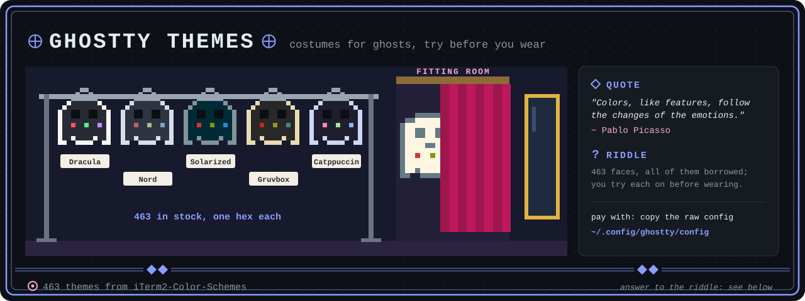

<p align="center">
  
</p>

#  Ghostty Theme Browser

An interactive browser for exploring all 463+ Ghostty terminal color themes with live previews.

<details>
<summary>Riddle answer</summary>

A Ghostty theme from iTerm2-Color-Schemes: the browser previews each of the 463 with sample code, errors and output before you copy its raw colours into your config.

</details>

## Features

- **Search & Filter** — Quickly find themes by name
- **Live Preview** — See how themes look with sample code, errors, success messages, and more
- **Color Palette** — View all color definitions in the theme
- **Raw Content** — Display the raw Ghostty config format with syntax-highlighted hex values
- **Keyboard Navigation** — Use `Shift + ↑/↓` to navigate between themes
- **Shareable URLs** — Each theme gets its own URL via hash navigation for easy sharing
- **Browser History** — Use back/forward buttons to navigate themes
- **[Keyboard Shortcuts Reference](keybindings.html)** — Complete guide to Ghostty keybindings for Windows/Linux and macOS

## Getting Started

### Opening the Browser

1. Open `index.html` in your web browser (Chrome, Safari, Firefox, Edge, etc.)
2. The browser will load all 463 themes automatically
3. The first theme in the list will be displayed by default

## How to Use

### Searching for Themes

1. **Search Box** — Type in the search box at the top of the sidebar to filter themes by name
   - Search is case-insensitive and matches partial names
   - Example: type "dark" to find all dark-themed variants
   - Clear the search box to see all themes again

### Navigating Themes

**Click to Select:**
- Click any theme name in the sidebar to view it immediately

**Keyboard Navigation:**
- Press `Shift + ↑` to go to the previous theme
- Press `Shift + ↓` to go to the next theme
- Navigate from any page while the theme list is visible

**Browser Navigation:**
- Click your browser's back button to return to the previously viewed theme
- Click forward to move to the next theme in your history

### Understanding the Preview

Each theme displays four preview sections:

1. **Code Syntax** — Shows how the theme colors JavaScript/TypeScript code with keywords, strings, and comments
2. **Error Message** — Displays error output styling with red text and error indicators
3. **Success Output** — Shows successful operation output in green with checkmarks
4. **Mixed Content** — Displays a mix of terminal output including warnings and statistics

### Viewing Colors

The **Color Palette** section shows all color definitions in the theme as colored squares:
- Hover over any color to see its name
- The hex value is displayed as the label below each color
- Maximum of 16 colors displayed

### Raw Theme Content

Below all previews, the **Raw Theme Content** section shows the Ghostty configuration format:
- Theme keys are displayed in light gray
- Hex color values are colored to match the actual color they represent
- Copy this content to use in your Ghostty config file

Example format:
```toml
[colors]
background = "#1e1e1e"
foreground = "#d4d4d4"
color-1 = "#f48771"
color-2 = "#6a994e"
```

### Sharing Themes

**Share a Theme URL:**
1. Select any theme in the browser
2. The URL automatically updates with the theme name (e.g., `index.html#Solarized_Dark`)
3. Copy the URL from your address bar and share it
4. Anyone who opens the link will see the same theme immediately

### Copying to Your Ghostty Config

1. Find a theme you like and open the Raw Theme Content section
2. Copy the color definitions from the raw content
3. Open your Ghostty config file (typically `~/.config/ghostty/config`)
4. Paste the color definitions into your config file
5. Restart Ghostty or reload the config to see the changes

## Themes

All 463 themes are sourced from [mbadolato/iTerm2-Color-Schemes](https://github.com/mbadolato/iTerm2-Color-Schemes) and adapted for Ghostty.

## Technical Details

### File Structure

- `index.html` — Main interactive browser application
- `download-themes.js` — Node.js script to fetch and parse themes from GitHub
- `data/themes.json` — Complete color definitions for all themes
- `data/themes-index.json` — Alphabetical index of theme names for fast searching

### Regenerating Theme Data

To update themes to the latest versions:

```bash
node download-themes.js
```

This script:
1. Fetches the list of all theme files from GitHub API
2. Downloads each theme file (463 total)
3. Parses Ghostty color format
4. Generates JSON data files
5. Displays progress and summary statistics

### No Dependencies

The browser uses only vanilla JavaScript—no build tools, frameworks, or dependencies required.

## Browser Compatibility

Works in all modern browsers:
- Chrome/Chromium (latest)
- Safari (latest)
- Firefox (latest)
- Edge (latest)

## Tips & Tricks

- **Dark Mode Themes** — Try searching for "dark" to find the most popular terminal themes
- **Light Mode Themes** — Search for "light" to find bright themes
- **Name Variations** — Many themes have multiple variants (e.g., "Solarized Dark", "Solarized Light")
- **Favorite Themes** — Bookmark theme URLs in your browser for quick access later
- **Quick Testing** — Use the keyboard navigation to quickly flip through similar themes

## License

MIT
